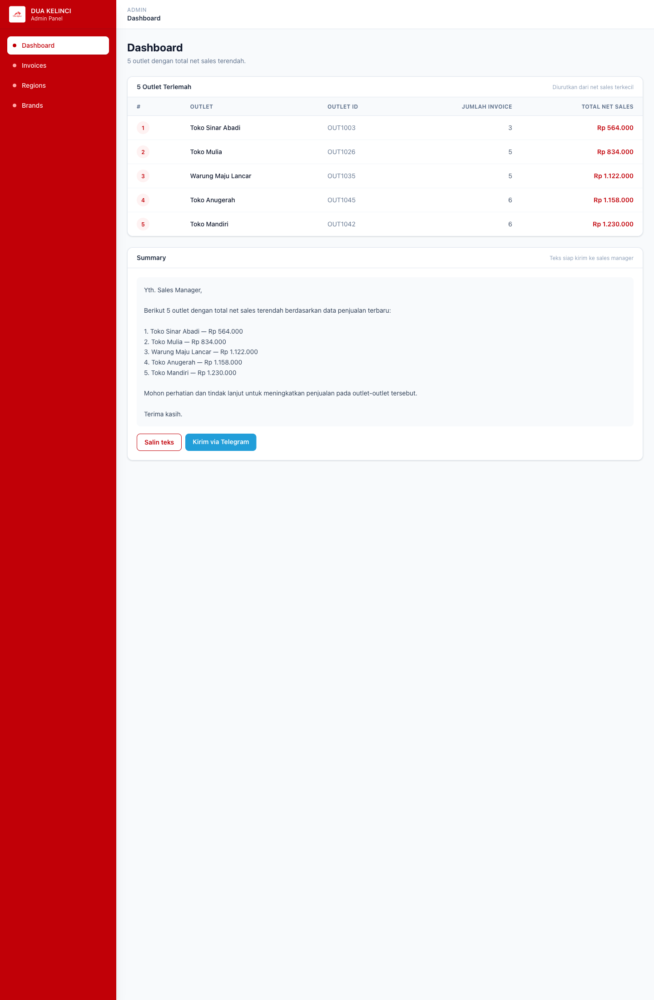
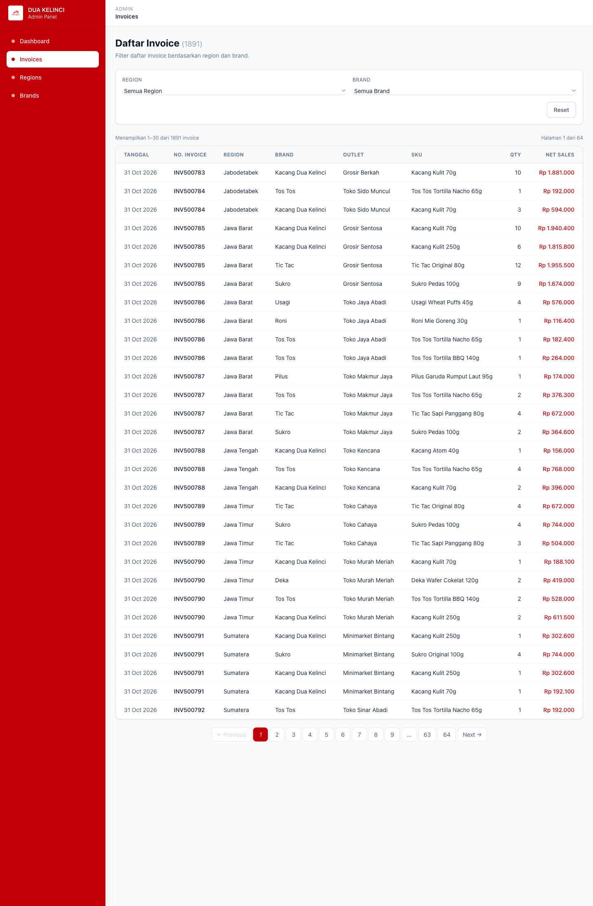
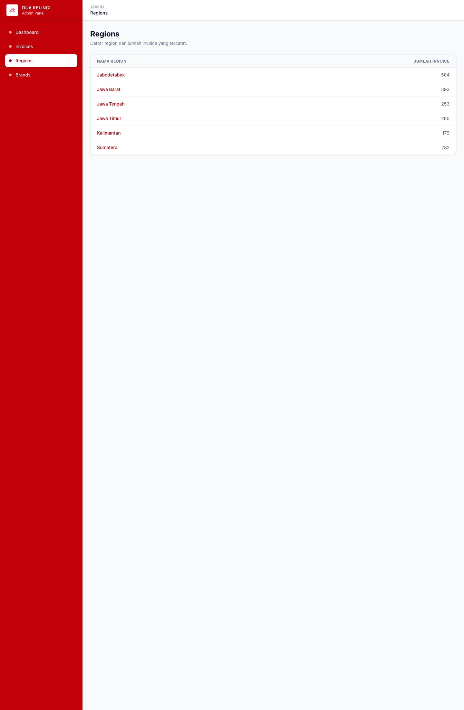
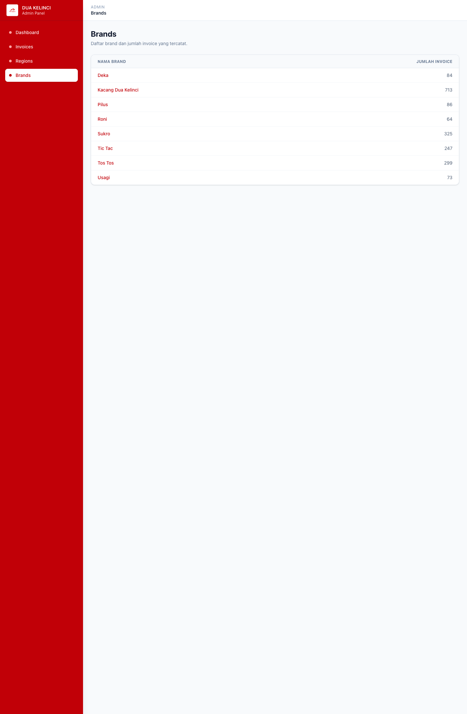

# Hello Dua Kelinci

Aplikasi Rails untuk mengimpor data penjualan invoice dari CSV dan menampilkannya
lewat halaman admin bertema merah putih. Data `brand` dan `region` disimpan di
tabel tersendiri; `invoices` berelasi ke keduanya lewat `brand_id` dan `region_id`.

## Requirement

- Ruby 3.4.8 (lihat `.ruby-version`)
- Rails 8.1
- SQLite3
- Node 22.18.0 via nvm (lihat `.nvmrc`)
- Yarn 1.22.22 (`packageManager` di `package.json`)

## Setup

```bash
nvm use
bundle install
yarn install
bin/rails db:prepare
```

## Frontend

Stack frontend sepenuhnya dijalankan lewat yarn (tanpa `importmap-rails`,
`jsbundling-rails`, `cssbundling-rails`, `turbo-rails`, atau `stimulus-rails` gem):

- **esbuild** untuk mem-bundle `app/javascript/application.js`
- **Tailwind CSS v4** lewat `@tailwindcss/cli`
- **Stimulus** dan **Turbo** dari npm (`@hotwired/stimulus`, `@hotwired/turbo-rails`)

Script yarn:

```bash
yarn build       # bundle JS ke app/assets/builds/application.js
yarn build:css   # build Tailwind ke app/assets/builds/application.css
yarn dev         # watch JS + watch CSS + bin/rails server
```

Untuk produksi, `assets:precompile` otomatis menjalankan `yarn install`,
`yarn build`, dan `yarn build:css` (lihat `lib/tasks/assets.rake`).

Stimulus controller yang tersedia:

- `sidebar_controller.js` — membuka/menutup sidebar di layar kecil (juga dengan Escape).
- `filter_controller.js` — otomatis submit form filter saat `<select>` diubah.

Kalau kamu menambah folder view baru, pastikan path-nya tercakup oleh directive
`@source` di `app/assets/stylesheets/application.tailwind.css`.

## Halaman admin

| URL          | Halaman                                                        |
| ------------ | -------------------------------------------------------------- |
| `/`          | Dashboard: 5 outlet dengan total net sales terendah             |
| `/invoices`  | Daftar invoice dengan filter region dan brand                   |
| `/regions`   | Daftar region dan jumlah invoice (nama region adalah link)      |
| `/regions/:id` | Daftar invoice untuk region tersebut                          |
| `/brands`    | Daftar brand dan jumlah invoice (nama brand adalah link)        |
| `/brands/:id` | Daftar invoice untuk brand tersebut                            |

Tabel invoice di `/invoices`, `/regions/:id`, dan `/brands/:id` memakai
`will_paginate` dengan 30 baris per halaman. Link pagination otomatis
mempertahankan filter region/brand yang sedang aktif. Di `/invoices`, filter
langsung diterapkan saat select diubah (tanpa tombol "Terapkan Filter").

Dashboard memiliki section **Summary** di bawah tabel: rangkuman bahasa Indonesia
tentang 5 outlet terlemah yang bisa disalin ke clipboard atau dibagikan lewat
tombol **Kirim via Telegram** (membuka dialog share `t.me`, tidak perlu bot/token).

Sidebar kiri berisi 4 menu berurutan: **Dashboard**, **Invoices**, **Regions**, dan **Brands**,
dengan penanda menu aktif (halaman detail region/brand tetap menyorot menu induknya). Logo di kiri atas dibaca dari
`app/assets/images/duakelinci_logo.jpeg` — tinggal ganti file itu kalau logo
resminya berubah.

## Screenshot

### Dashboard



### Invoices



### Regions



### Brands



## Import CSV

CSV bawaan ada di `db/csv/invoices.csv`. Jalankan:

```bash
bin/rails invoices:import_csv
```

Dengan path lain:

```bash
bin/rails "invoices:import_csv[db/csv/invoices.csv]"
CSV_PATH=db/csv/invoices.csv bin/rails invoices:import_csv
```

### Format CSV

Header yang diharapkan (15 kolom):

```text
date,invoice_no,region,branch,outlet_id,outlet_name,outlet_type,salesman,brand,sku,qty_carton,price_per_carton_idr,gross_sales_idr,discount_idr,net_sales_idr
```

- `date` harus berformat `YYYY-MM-DD`.
- 5 kolom terakhir (`qty_carton`, `price_per_carton_idr`, `gross_sales_idr`, `discount_idr`, `net_sales_idr`) harus berupa angka bulat.
- `region` dan `brand` wajib diisi.

### Perilaku task

Task ini **destruktif**: sebelum import, seluruh baris di `invoices`, `regions`,
dan `brands` dihapus, dan sequence primary key di-reset (ID mulai dari 1 lagi).

Prosesnya berjalan dalam satu transaction: jika ada baris CSV yang invalid
(misalnya tanggal salah atau region tidak dikenal), seluruh perubahan
di-rollback sehingga database kembali ke kondisi semula.

Data master dibuat otomatis dari CSV:

- `brands`: 8 brand dari kolom `brand` (nama unik).
- `regions`: 6 region dari kolom `region` (nama unik). Variasi seperti
  `Jabar`, `JAWA BARAT`, dan `Jawa Barat` dinormalisasi menjadi `Jawa Barat`;
  `JABODETABEK` menjadi `Jabodetabek`, dan `JAWA TIMUR` menjadi `Jawa Timur`.

Data lain diimpor apa adanya: field kosong disimpan sebagai `NULL`
(termasuk 5 baris dengan `salesman` kosong pada CSV bawaan).

Task menampilkan ringkasan jumlah data yang dihapus, jumlah baris yang
diimpor, dan jumlah baris dengan `salesman` kosong.

## Struktur tabel

- `brands` — `id`, `name` (unique), `created_at`, `updated_at`
- `regions` — `id`, `name` (unique), `created_at`, `updated_at`
- `invoices` — `id`, `date`, `invoice_no`, `region_id`, `brand_id`, `branch`,
  `outlet_id`, `outlet_name`, `outlet_type`, `salesman`, `sku`, `qty_carton`,
  `price_per_carton_idr`, `gross_sales_idr`, `discount_idr`, `net_sales_idr`,
  `created_at`, `updated_at`

`invoices.region_id` dan `invoices.brand_id` memiliki foreign key ke tabel
`regions` dan `brands`. Ada pula index pada `invoice_no` dan `date`.

## Verifikasi

```bash
bin/rails runner 'puts [Invoice.count, Region.count, Brand.count].inspect'
# => [1891, 6, 8] untuk CSV bawaan
```

## Menjalankan test

```bash
bin/rails test
```

---

<p align="center">build with <a href="https://opencode.ai">opencode</a></p>
